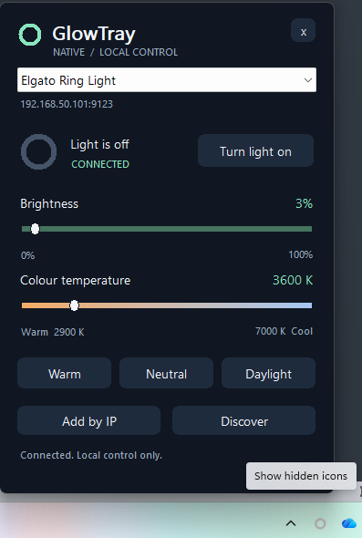

# GlowTray

A tiny native Windows tray controller for Elgato lights. Vibe coded because the official app doesn't work reliably.



## Run

Choose the **x64** download for Intel/AMD PCs or **ARM64** for Windows on Arm.
Download either the portable executable or EXE installer from GitHub Actions (see below).
For a local x64 build, run **`artifacts\GlowTray\x64\GlowTray.exe`**.
The portable x64 release is approximately **400 KiB**, with a statically linked C++ runtime.
It uses Windows system DLLs only: no .NET runtime, browser engine, external DLLs, installer,
or administrator access is required. Windows 10 or later is required.

The optional EXE installer installs to `%LOCALAPPDATA%\Programs\GlowTray`, adds a Start menu
shortcut and an entry in Windows' installed-apps list, and needs no administrator access.
Startup remains opt-in in the tray menu. Upgrading preserves settings and updates an already
enabled startup entry to the installed path. Before upgrading or uninstalling, use **Exit**
in GlowTray's tray menu; closing the popup only hides it. Uninstall removes the installed
app and its startup entry, but retains saved lights and logs.

Single-click the ring icon in the system tray to open a compact control popup beside it.
Click again, press Escape, click outside, or use the popup's close button to hide it.
The app stays in the tray, with no taskbar button. The panel includes a light selector,
power, brightness, colour temperature, Warm/Neutral/Daylight presets, discovery,
and manual IP entry. Sliders also work with the keyboard. Tray keyboard activation
opens the panel as well.

Right-click the icon for **Start with Windows**, the data folder, forgetting the selected
light, and **Exit**. Startup is opt-in. `--tray` starts hidden; `--add <address>` connects
to and selects a specific light. A second launch opens the existing popup.

Network operations run in background threads. Slider edits are debounced and combined,
and writes take priority over polling. Only changed fields are sent, with an explicit
Content-Length for compatibility with Ring Light firmware. Successful writes are read
back from the light. Offline controls are disabled and reconnect automatically.

Discovery uses Windows mDNS for `_elg._tcp.local`, then checks Elgato's port 9123 on
directly attached Wi-Fi/Ethernet networks if multicast finds nothing. Large networks
are bounded to the local /24; VPN/tunnel interfaces are excluded. Candidates must pass
the white-light API check before being added. Saved lights reconnect independently.
Your light must already be connected to Wi-Fi; this does not provision lights or update
their firmware. White Ring Light/Key Light devices are supported, not RGB strips or MK.2.

Settings and rotating logs are in `%LOCALAPPDATA%\GlowTray`.
Saved light addresses and enabled startup preferences migrate automatically when upgrading.

## Build and check

Requires MSVC C++ Build Tools for the target architecture, a Windows SDK, and PowerShell 7
on Windows. No packages or third-party application libraries are downloaded by the build.

```powershell
pwsh -File native\build.ps1 -Architecture x64
pwsh -File native\UiSmoke.ps1 -Architecture x64
```

Build outputs are `artifacts\GlowTray\<architecture>\GlowTray.exe` and
`artifacts\native-obj\<architecture>\GlowTray.Tests.exe`. The default architecture is x64.
On an ARM64 Windows host, use `-Architecture arm64` to build and run the ARM64 regression
checks. Cross-compiling ARM64 on x64 requires the MSVC ARM64 tools and `-SkipTests`;
run the tests on an ARM64 host instead.

The build produces `GlowTray.exe` and runs the protocol/settings regression checks.
The isolated UI check uses a native simulated light on loopback, restores native settings,
and exercises controls, disconnect/reconnect, tray activation/dismissal, single-instance
behaviour, startup migration, and clean exit. Close GlowTray before running it.

Optional read-only real-device checks:

```powershell
artifacts\native-obj\x64\GlowTray.Tests.exe --live <address>
artifacts\native-obj\x64\GlowTray.Tests.exe --discover
```

Adding `--verify-write` after `--live <address>` re-applies the light's existing brightness
and verifies that its full state remains unchanged.

To package a build, install **Inno Setup 6.3 or later**, then run:

```powershell
pwsh -File native\package.ps1 -Architecture x64
```

Use the same architecture as the build. `-Compiler <path to ISCC.exe>` selects a compiler
outside the usual Inno Setup 6 installation paths. Packaging checks the executable's PE
architecture and uses its product version to create
`artifacts\installers\<architecture>\GlowTray-<version>-<architecture>-Setup.exe`.

## License

[MIT](LICENSE)
